# 🏗️ Architectural Separation: TeamZero System vs. TeamZero Builder (The Builder Boundary)
*Design Specification & Operational Separation Protocol*

> [!IMPORTANT]
> **The Golden Law of Compiler & Platform Self-Hosting:**
> In computer science, compiler self-hosting (like `gcc` compiling `gcc`, or `rustc` compiling `rustc`) succeeds only because of a strict tripartite separation:
> 1. **The Host (Stage 0):** The trusted, immutable binary that executes the build.
> 2. **The Builder (Toolchain):** The orchestrator, test gauntlet, and compiler pipeline.
> 3. **The Target (Stage 1):** The newly generated source code under construction.
>
> If the Target is allowed to overwrite the Host while running, the compiler corrupts itself.
> **TeamZero enforces this exact boundary between the TeamZero Core System and the TeamZero Builder.**

---

## 1. The Dual-Repository / Boundary Topology

```mermaid
flowchart LR
    subgraph BuilderPlane["🛡️ BUILDER PLANE (Stage 0: The Foundry)"]
        B1["TeamZero Builder Engine\n(External Orchestrator)"]
        B2["Protected Constitution\n(.teamzero/constitution.yaml)"]
        B3["Sovereign Mint Authority\n(TZ_SERVER_SECRET in CI / Host)"]
        B4["Merge Gate Authority\n(merge_gate.py)"]
        B5["Subprocess Test Sandboxes\n(Docker / Isolated venv)"]
    end

    subgraph TargetPlane["📦 TARGET PLANE (Stage 1: The Product Under Construction)"]
        T1["Target Repo: teamzero/ or einstein_simulator/"]
        T2["Draft Branches: feature/add-dynamic-probes"]
        T3["Candidate Source Code"]
        T4["Candidate Test Suites"]
    end

    BuilderPlane -- "1. Ingests Spec & Issues Task" --> TargetPlane
    TargetPlane -- "2. Submits Candidate Commits" --> BuilderPlane
    BuilderPlane -- "3. Executes Gauntlet & Breaker in Sandbox" --> BuilderPlane
    BuilderPlane -- "4. Computes Receipt (Done is Computed)" --> BuilderPlane
    BuilderPlane -- "5. Merges if All 4 Gates Pass" --> TargetPlane

    style BuilderPlane fill:#e8f4fd,stroke:#1a73e8,stroke-width:2px
    style TargetPlane fill:#fff3e0,stroke:#f57c00,stroke-width:2px
```



---

## 2. The 4 Non-Negotiable Boundaries

### Boundary 1: Process & Memory Isolation (No Live Self-Mutation)
- **The Rule:** An agent running inside a Python process executing `teamzero` cannot import and live-monkey-patch the running server's classes or functions.
- **Enforcement:**
  - The Builder executes the candidate code in an **isolated subprocess** (`subprocess.run([sys.executable, ...])`) or clean virtualenv.
  - The candidate code runs with read-only view of the host system files.
  - Even if the candidate code crashes, has memory leaks, or contains `sys.exit()`, the Builder process remains stable.

### Boundary 2: Secret & Key Boundary (The Mint Authority)
- **The Rule:** The candidate code must never receive `TZ_SERVER_SECRET`.
- **Enforcement:**
  - Candidate code running in the sandbox has `TZ_SERVER_SECRET` removed from its environment variables (`env=clean_env`).
  - Cryptographic HMAC receipts (`TZ-{sha256}`) are minted **exclusively by the Builder Host** after the subprocess finishes with returncode 0.
  - A candidate commit claiming it has a receipt cannot trick the Builder, because the receipt is signed with a secret the candidate never touched.

### Boundary 3: Constitutional Immutability (Write-Protected Manifest)
- **The Rule:** An agent improving TeamZero cannot edit the governance rules that evaluate it.
- **Enforcement:**
  - The files `.teamzero/constitution.yaml`, `.github/workflows/*`, and `.teamzero/ledger/*` are marked as **Host-Protected Paths**.
  - Any pull request or candidate branch authored by an AI agent that includes modifications to these protected paths is automatically rejected by the `gate_secret_scan` and `NeurosymbolicValidator` with:
    `[GUARDRAIL_BLOCKED: VIOLATION_INV_04] Protected constitution paths cannot be modified by autonomous agents.`

### Boundary 4: Workspace & Branch Separation
- **The Rule:** The Builder operates on distinct Git refs.
- **Enforcement:**
  - The core production code lives on `main` / `master` with branch protection enabled.
  - The Builder creates ephemeral feature branches (e.g., `builder/task-xyz`).
  - Merge Gate Authority only promotes a candidate branch to `main` when:
    1. Deterministic gauntlet passes (static tests).
    2. Dynamic gauntlet passes (resource + boundary probes).
    3. Red team breaker passes (zero critical findings).
    4. Founder explicitly confirms via `tz inbox` (Tier 2 approval).

---

## 3. Step-by-Step Self-Build Execution Scenario

How the **Builder** upgrades the **System**:

```
[1] Founder requests improvement:
    Founder runs `tz ideate` -> "Refactor smart_reader.py to use tree-sitter AST"

[2] Builder provisions isolated sandbox:
    Builder checks out branch `builder/refactor-smart-reader` in an isolated temp workspace.

[3] Generator Agent drafts implementation:
    Generator agent writes candidate `smart_reader.py` inside the temp workspace.

[4] Builder runs Stage 0 Gauntlet against Stage 1 Candidate:
    The HOST Builder (Stage 0) launches a fresh subprocess running `pytest tests/test_smart_reader.py` against the CANDIDATE (Stage 1).
    - Host records CPU time, peak RAM, and exit code.
    - Candidate never sees Host's private memory or secrets.

[5] Builder Red-Team Breaker attacks Candidate:
    Host runs Phase D Thinking Cracker (`teamzero_ai_redteam`) to synthesize exploits against the Candidate.

[6] Host Mints Receipt:
    If all tests pass, the Host mints HMAC receipt `TZ-9a8f...` and logs it in `.teamzero/ledger/receipts.jsonl`.

[7] Founder Promoted Merge:
    The candidate is merged into main. The newly verified `smart_reader.py` now becomes part of Stage 0 for future builds!
```

---

## 4. Summary Table: System vs. Builder

| Dimension | TeamZero Target System (Product) | TeamZero Builder (Foundry) |
| :--- | :--- | :--- |
| **Location** | `teamzero/` source files & feature branches | Host runtime, CLI (`tz`), and CI runner |
| **Permissions** | Sandboxed, read-only to constitution | Sovereign mint authority, holds `TZ_SERVER_SECRET` |
| **Lifecycle** | Ephemeral, modified on every task | Stable Stage-0 baseline, updated only after merge |
| **Execution** | Child subprocess / isolated venv | Parent supervisor process |
| **Failure Cost** | Deducts token budget, decays agent trust | Unaffected, issues rollback via Ratchet |
