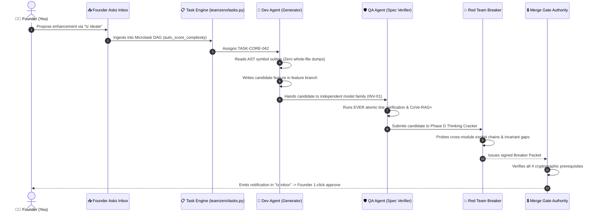

# 🧬 Self-Bootstrapping: Building TeamZero with TeamZero
*Architectural Blueprint for Recursive Self-Improvement (RSI) under Invariant Governance*

> [!IMPORTANT]
> **Can an AI build the very tools that control it?**
> Yes—Anthropic uses Claude to write the majority of Claude's internal code, and OpenClaw 2.0 was developed using "self-directed skills" and "multiplayer AI coding".
> But uncontrolled Recursive Self-Improvement risks **model collapse**, **hallucination feedback loops**, and **security escape**.
> 
> **TeamZero achieves safe self-building because the rules are outside the agent's reach.**

---

## 1. The Core Paradox: How Can TeamZero Edit Itself Safely?

```mermaid
flowchart TD
    subgraph Danger["❌ Unsafe Self-Editing (Vibe Coding Collapse)"]
        D1["AI Agent edits its own gate"] --> D2["Agent deletes failing test"]
        D2 --> D3["Agent approves its own PR"]
        D3 --> D4["Slop Accumulation & Catastrophic Crash"]
    end

    subgraph Safety["✅ TeamZero Invariant Architecture"]
        S1["Agent writes candidate improvement in isolated branch"] --> S2["QA Agent tests against SPEC (INV-02)"]
        S2 --> S3["Dynamic Gauntlet runs in subprocess sandbox"]
        S3 --> S4["Protected Constitution BLOCKS agent from editing rules (INV-04)"]
        S4 --> S5["HMAC Receipt minted by system, not agent (INV-03)"]
        S5 --> S6["Founder signs off in tz inbox"]
    end
```



The fundamental reason TeamZero can safely build itself is **the separation between the *Worker* and the *Judge*:**

1. **INV-01 (Generator Never Verifies):** The agent that authored `teamzero/tasks.py` cannot author or approve the acceptance tests for it.
2. **INV-04 (Protected Constitution):** No agent has write access to `.teamzero/constitution.yaml`, GitHub Actions workflow configs, or `TZ_SERVER_SECRET`. An agent trying to relax a test rule is blocked before execution.
3. **INV-03 (Done is Computed):** An agent cannot modify its own trust score or declare its pull request complete. The Merge Gate Authority checks 4 signed HMAC receipts before a merge can occur.

---

## 2. The Self-Building Loop (Step-by-Step)

When TeamZero builds new capabilities for itself (like adding a new MCP tool or refactoring `teamzero/smart_reader.py`), it follows this exact cycle:



### Phase 1: Ingestion via the Founder Inbox
You don't write the code. You type:
```bash
tz ideate --title "Add Tree-sitter parallel parser for 25 languages"
```
TeamZero's ideation engine breaks the idea into non-negotiable invariants, failure modes, and decision-table rules, creating a structured Ask in `.teamzero/inbox/asks/`.

### Phase 2: Autonomous Decomposition & Self-Scoring
TeamZero's Task Engine (`teamzero/tasks.py`) scores the work:
```python
score = reg.auto_score_complexity(target_files=["teamzero/wiki.py"], description="Tree-sitter parser")
# Score = 7/10 -> Automatically expands into 3 atomic microtasks
```

### Phase 3: Generation & Multi-Model Review (INV-01)
- **Generator Agent** (e.g., Claude Sonnet 4.6) drafts the code in a sandboxed feature branch.
- **QA Verifier Agent** (e.g., Gemini 3.8 Flash) tests the draft against the spec—**never seeing the diff first** (INV-02).
- The agent runs `teamzero_ever_verify` to audit every imported symbol against existing AST reality.

### Phase 4: Self-Attacking via Phase D Red Team
Before TeamZero adopts its own code, it attacks itself using `teamzero_ai_redteam`:
- *"Can this new MCP tool be spoofed with `caller_id='verified'`?"*
- *"Does this new function create an unhandled infinite loop or memory leak?"*
- Only when all attacks are repelled does the system emit an HMAC-signed receipt.

### Phase 5: The Merge Gate Handshake
The agent runs:
```bash
tz check-merge HEAD
```
If the gauntlet passes, the breaker packet is clean, and the evidence graph is verified, TeamZero prompts the Founder for the final Tier 2 confirmation before pushing to remote.

---

## 3. Comparison: TeamZero vs. OpenClaw vs. Anthropic RSI

| Capability | Anthropic Internal RSI | OpenClaw 2.0 | TeamZero Self-Building |
| :--- | :--- | :--- | :--- |
| **Self-authored skills** | Internal CI scripts | Modular `SKILL.md` files | Living Wiki + 69 MCP tools |
| **Execution Surface** | Internal Kubernetes sandboxes | Node VM / QuickJS Gateway | FastMCP subprocesses + tracemalloc |
| **Anti-Slop Protection** | Heavy human RLHF review | Community PR reviews | **Cryptographic Merge Gate + 5 Invariants** |
| **Multi-Agent Diversity** | Homogeneous Claude models | Community + AI agents | **Heterogeneous Swarms (INV-01)** |
| **Memory Persistence** | Cloud databases | Shared cloud workspaces | **Git-backed ADRs + Trap Cards + Living Maps** |
| **Run Cost** | Millions of compute dollars | Cloud subscription | **Zero-budget local execution + free-tier models** |

---

## 4. The 3 Golden Guardrails for TeamZero Self-Building

To ensure TeamZero never destroys itself during recursive development:

1. **The Sandbox Ceiling:** New MCP tools are registered in `teamzero/mcp_server.py` wrapped by `_wrap_with_neurosymbolic_hook()`. If an agent writes a tool that attempts path traversal (`../`) or exceeds complexity limits, the framework intercepts and blocks it before execution.
2. **Immutable Constitutional Core:** The file `.teamzero/constitution.yaml` and the Git hooks in `.github/workflows/` are marked as **read-only invariant targets**. Any commit modifying them without explicit Founder private key signature fails `gate_secret_scan` and blocks the merge.
3. **The Self-Healing Ratchet (`teamzero/ratchet.py`):** If an agent-authored self-improvement introduces a regression that breaks existing unit tests, the Ratchet rolls back the branch, deducts trust points from that agent's ledger, and files a Trap Card so future iterations avoid the same mistake.
