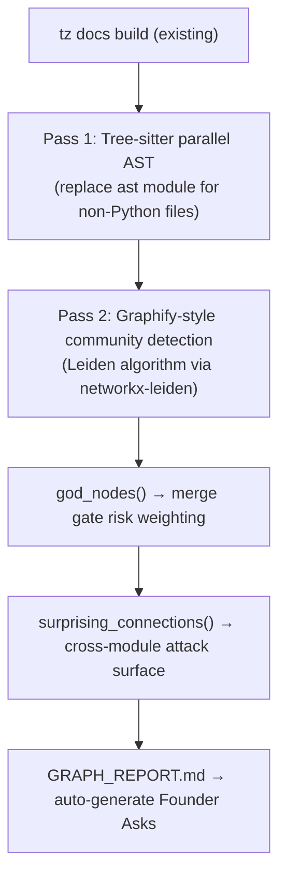
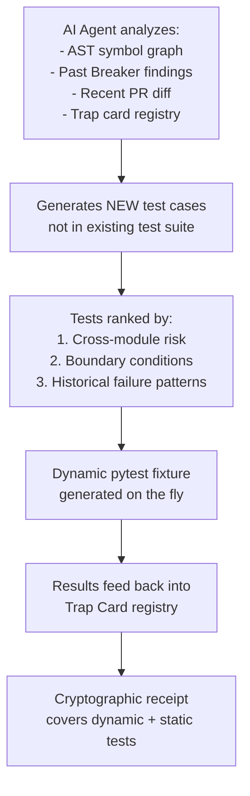
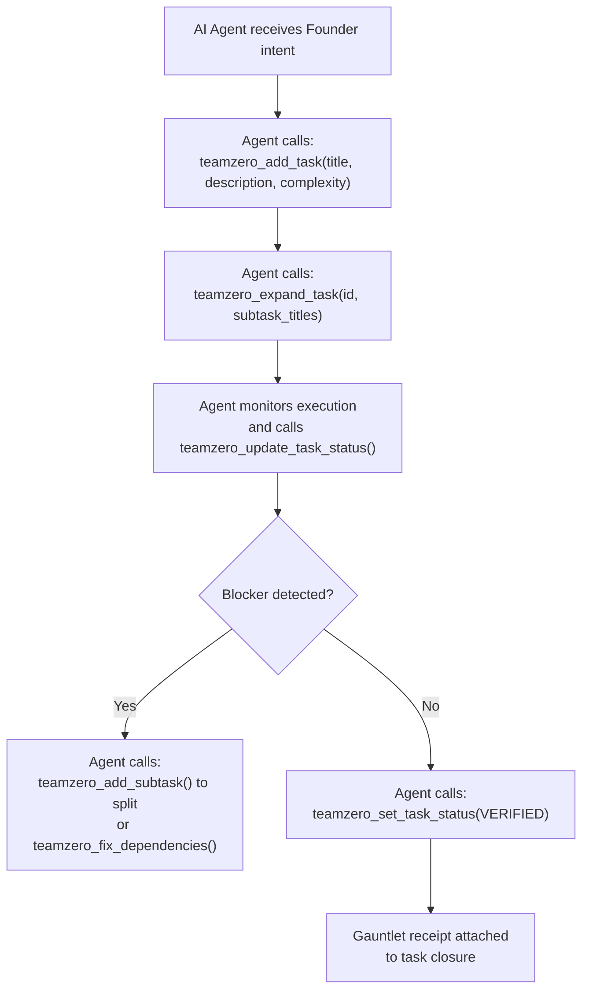
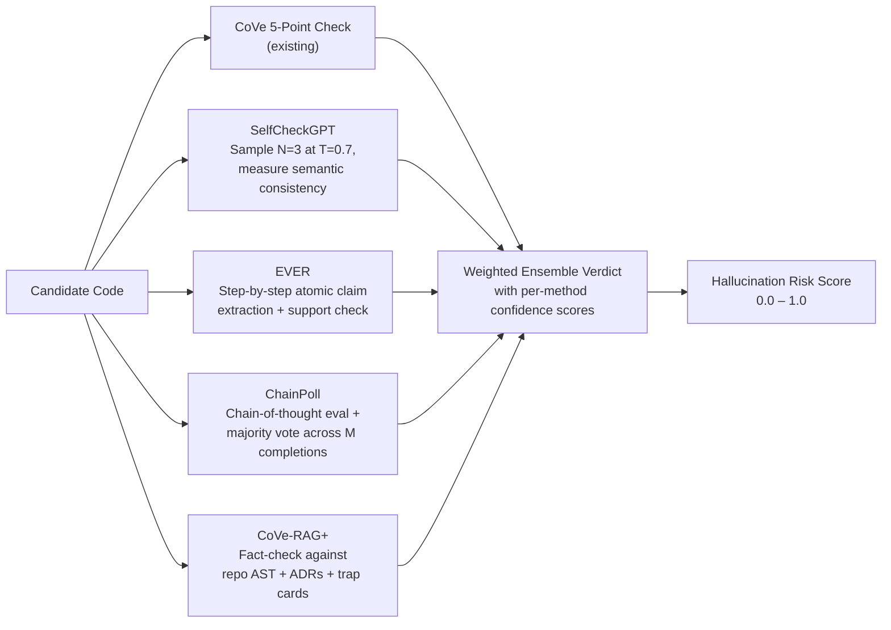
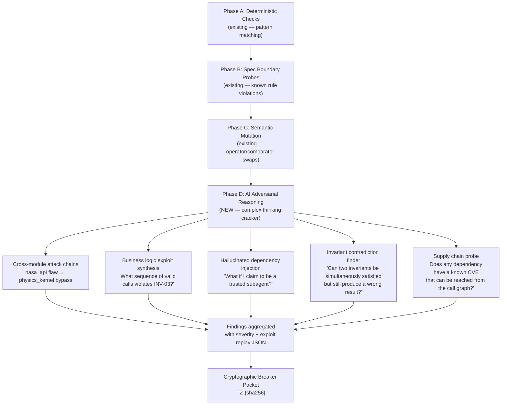
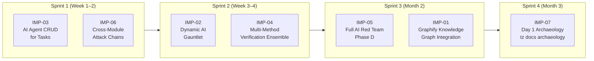

# 🛠️ TeamZero Improvement Plan
*Generated: 2026-10-13 | Branch: fix/p1-security-and-quality-hardening*

> [!IMPORTANT]
> This document captures **all planned enhancements** distilled from: Graphify source-code deep analysis (`d:\Workspace\graphify_analysis`), AI stress-testing research (Tricentis/PractiTest/TFTUS), AI penetration testing research (Synack/Tricentis), and CoVe/hallucination-reduction literature (SelfCheckGPT, EVER, ChainPoll, CoVe-RAG+).
>
> Each improvement is marked with: **Priority**, **Complexity**, **Source**, and **Target Module**.

---

## Priority Legend

| Badge | Meaning |
| :--- | :--- |
| 🔴 **P0** | Must-have. Blocks autonomous reliability. |
| 🟠 **P1** | High value. Significant capability jump. |
| 🟡 **P2** | Important. Reduces friction at Year-1 scale. |
| 🟢 **P3** | Nice-to-have. Long-term horizon (Year 2–3). |

---

## 🗺️ IMP-01: Graphify-Powered Knowledge Graph for Day 1 Onboarding

**Priority:** 🟠 P1 | **Complexity:** Medium | **Target Module:** `teamzero/wiki.py` + new `teamzero/graph_ingest.py`

**Source:** Deep analysis of [`graphify/ARCHITECTURE.md`](file:///d:/Workspace/graphify_analysis/ARCHITECTURE.md) and [`graphify/how-it-works.md`](file:///d:/Workspace/graphify_analysis/docs/how-it-works.md)

### What Graphify Actually Does (from the Source Code)

From reading the real code, Graphify runs **three distinct passes**:

1. **Pass 1 — Free, no API calls:** Tree-sitter parses every code file into AST nodes and edges. Supports 25+ languages including Python, TypeScript, Rust, Go, C++, SQL. The `detect.py` module recognizes 80+ file extensions. Runs as `ProcessPoolExecutor` for parallel extraction.
2. **Pass 2 — Local Whisper transcription:** Video/audio files get transcribed with faster-whisper, seeded by *your existing top god-nodes* to make domain-specific transcription more accurate.
3. **Pass 3 — Claude subagents (costs tokens):** Docs, PDFs, images, and screenshots each get their own Claude subagent that outputs `{nodes, edges, hyperedges}` fragments, which are merged via the `build.py` NetworkX graph assembler.

Key internal patterns extracted from the source:

```python
# From graphify/cache.py — SHA256 per-file caching so re-runs skip unchanged files
# AST cache namespaced by: package version + cache schema version + tree-sitter grammar fingerprint
# Semantic (LLM) cache deliberately NOT version-namespaced (to avoid re-billing on releases)

# From graphify/analyze.py — god_nodes(), surprising_connections(), suggest_questions()
# Community detection via Leiden algorithm (no embeddings needed — graph structure IS the similarity signal)
# Confidence tagging: EXTRACTED (1.0) | INFERRED (0.55–0.95) | AMBIGUOUS (human review)

# From graphify/dedup.py — entity deduplication pipeline
# exact normalization → entropy gate → MinHash/LSH blocking → Jaro-Winkler verification → union-find merge

# From graphify/security.py — all external input sanitized
# validate_url() → safe_fetch() → validate_graph_path() → sanitize_label()
# SSRF protection: blocks metadata.google.internal, CGN networks (100.64.0.0/10), link-local
```

### What to Adapt for TeamZero

TeamZero's `wiki.py` uses Python `ast` module for symbol extraction. Graphify uses **Tree-sitter** — which is faster, parallel, and supports 25 languages (not just Python). Key adaptations:

| Graphify Pattern | Adapt to TeamZero As |
| :--- | :--- |
| SHA256 per-file content cache (`cache.py`) | **Upgrade SQZ cache** from session-only to persistent on-disk; namespace by `teamzero_version + ast_schema` |
| `god_nodes(G)` — most connected abstractions | **`teamzero_get_god_nodes` MCP tool** — surfaces highest-coupling modules for merge gate risk-weighting |
| `surprising_connections(G)` — cross-community edges | **Cross-module attack surface detector** — flag unexpected imports between `nasa_api.py` ↔ `physics_kernels.py` as security concern |
| `check_update(watch_path)` live watcher | **`tz docs watch`** — hot-reload wiki cards on file save during active development |
| `GRAPH_REPORT.md` god-nodes + questions | **Feed into `tz ideate`** — auto-generate Founder Asks from architectural complexity hotspots |
| Leiden community detection (no embeddings) | **TeamZero module clustering** — group related modules to guide multi-agent task assignment |
| `validate_extraction()` schema enforcement | **TeamZero Living Map card schema validation** — reject malformed map cards before indexing |
| MinHash/LSH deduplication (`dedup.py`) | **Duplicate Trap Card detector** — prevent registering semantically equivalent failure modes twice |

### Implementation Plan



**New MCP Tools to add:**
- `teamzero_get_god_nodes` — top N highest-coupling symbols
- `teamzero_get_surprising_connections` — cross-community edge detector
- `teamzero_watch_docs` — live hot-reload on file change

---

## 🧪 IMP-02: Dynamic AI-Generated Gauntlets (Replace Hardcoded Tests)

**Priority:** 🔴 P0 | **Complexity:** High | **Target Module:** `teamzero/dynamic_gauntlet.py` (new)

**Source:** AI Stress Testing research (Tricentis NeoLoad, PractiTest, TFTUS) + user comment

### The Problem

The current `tz gauntlet` runs a fixed `pytest tests/ -q` — **hardcoded test scripts**. This is reliable but blind to:
- Hidden bugs that don't have a pre-written test yet
- Performance failures (GPU VRAM leaks, API timeout cascades)
- Edge cases discovered from usage patterns, not from developer imagination

For a project like `Einstein_simulator` with GPU physics kernels, NASA API integration, and Blender viewport rendering, hardcoded `pytest` tests miss:
- GPU VRAM exhaustion after 10,000 N-body steps
- NASA TAP API returning 503 during burst parallel queries
- Blender crash when rendering > 1,000 simultaneous orbit trails

### The Enhancement: AI-Driven Dynamic Gauntlet



**New capability: Performance Gauntlet Layer**

| Test Type | Implementation |
| :--- | :--- |
| **Unit + Integration (existing)** | `pytest tests/ -q` (current) |
| **Dynamic edge-case generation** | AI reads AST graph → generates boundary tests for all uncovered parameter combinations |
| **API resilience probes** | Simulate NASA TAP 503 / timeout / malformed JSON responses |
| **Memory/resource profiling** | `tracemalloc` + GPU memory hooks for physics kernel runs |
| **Performance regression gate** | Assert `execution_time < baseline * 1.2` for critical paths |
| **Cross-module integration probes** | Trace call chains from `nasa_api.py` → `integrator.py` → `physics_kernels.py` |

**New MCP Tools to add:**
- `teamzero_generate_dynamic_tests` — AI-generated test cases from AST analysis
- `teamzero_run_performance_gauntlet` — resource profiling gate
- `teamzero_get_uncovered_paths` — coverage gap reporter

---

## 🤖 IMP-03: AI Agent CRUD for Tasks and Subtasks

**Priority:** 🟠 P1 | **Complexity:** Medium | **Target Module:** `teamzero/tasks.py` + `teamzero/mcp_server.py`

**Source:** User comment on Task DAG section

### The Problem

Currently, tasks and subtasks are created/updated via structured JSON files or CLI commands. This requires the Founder or agent to manually compose the exact schema. It misses the opportunity for AI agents to autonomously:
- Detect blockers and split tasks mid-flight
- Merge redundant subtasks discovered via god-node analysis
- Re-prioritize based on Red Team Breaker findings

### The Enhancement



**New AI-native CRUD capabilities:**

| Operation | Current | Enhancement |
| :--- | :--- | :--- |
| **Create task from natural language** | Manual JSON schema | `teamzero_parse_prd("Add gravitational wave calculations")` → auto-decompose |
| **Detect and split blocked tasks** | Manual | Agent monitors status → auto-splits if complexity drifts > 7/10 |
| **Merge duplicate tasks** | Manual | MinHash similarity (from Graphify's `dedup.py` pattern) across task descriptions |
| **Auto-assign complexity scores** | Manual estimate | AST-aware: count external dependencies, call depth, referenced invariants |
| **Priority re-ranking on Breaker findings** | None | When Breaker finds `CRITICAL` in a related module, re-prioritize associated tasks |
| **Subtask generated from god-node risk** | None | If god-node analysis shows high coupling, auto-generate "Add integration tests for {module}" subtask |

**Existing MCP tools (already implemented) to wire to AI agents:**
`teamzero_get_tasks`, `teamzero_get_task`, `teamzero_add_task`, `teamzero_expand_task`, `teamzero_add_subtask`, `teamzero_remove_subtask`, `teamzero_update_task_status`, `teamzero_fix_dependencies`

**New MCP tools needed:**
- `teamzero_merge_duplicate_tasks` — MinHash-based semantic dedup
- `teamzero_reprioritize_from_breaker` — re-rank task list based on latest Breaker packet
- `teamzero_auto_score_complexity` — AST-driven complexity estimation

---

## 🧠 IMP-04: Enhanced Verification Beyond CoVe

**Priority:** 🟠 P1 | **Complexity:** High | **Target Module:** `teamzero/cove.py` (enhance)

**Source:** User-provided research on SelfCheckGPT, EVER, ChainPoll, CoVe-RAG+, Self-Consistency

### The Problem

The current `cove.py` runs a single-pass 5-point verification plan. It doesn't:
- Sample multiple responses and compare consistency (SelfCheckGPT)
- Perform step-by-step atomic claim verification during generation (EVER)
- Run a polling/voting ensemble across multiple model completions (ChainPoll)
- Pull ground-truth from external authority documents (CoVe-RAG+)

### The Enhancement: Multi-Method Verification Ensemble



**Method details:**

| Method | What It Adds | TeamZero Implementation |
| :--- | :--- | :--- |
| **SelfCheckGPT** | Samples 3 responses at temperature=0.7; flags facts that appear in <2/3 | `compute_self_consistency()` already exists — extend to measure semantic drift |
| **Self-Refinement** | Iterative rewrite loop: model critiques its own draft | Add `refine_until_verified(code, max_iterations=3)` |
| **EVER** | Per-sentence atomic claim extraction + evidence grounding | New `ever_verify(code)` — tokenize by statement, verify each against repo AST |
| **ChainPoll** | Chain-of-thought + polling vote across completions | Extend `compute_self_consistency()` to use structural AST similarity voting |
| **CoVe-RAG+** | Pull ground-truth from external docs (ADRs, NASA papers, LIGO data) | `cove_rag_verify(code, authority_docs=[".teamzero/memory/adr/*.md"])` |
| **Self-Consistency** | Majority voting over diverse reasoning paths (already partial in TeamZero) | Extend `compute_self_consistency()` to use Jaccard + semantic similarity ensemble |

**New MCP Tools:**
- `teamzero_selfcheck_verify` — SelfCheckGPT-style consistency sampling
- `teamzero_ever_verify` — atomic step-by-step claim validation
- `teamzero_rag_verify` — RAG-enhanced CoVe against ADRs and authority docs
- `teamzero_ensemble_verify` — weighted multi-method hallucination risk score

---

## 💥 IMP-05: Full AI Red Team — Thinking Adversarial Cracker

**Priority:** 🔴 P0 | **Complexity:** Very High | **Target Module:** `teamzero/redteam.py` (new, replaces `mutation.py` patterns)

**Source:** User comment on Red Team Breaker section + AI pentesting research

### The Problem

The current `l1_pass.py` Breaker runs **three phases**:
- Phase A: Deterministic (AST pattern checks, dummy test detection)
- Phase B: Spec probes (boundary inputs against known rules)
- Phase C: Semantic mutation (`<` → `<=` swap)

This is deterministic and spec-bound. It misses:
- **Cross-module attack chaining** — using a flaw in `nasa_api.py` to bypass invariants in `physics_kernels.py`
- **Business logic attacks** — crafting payloads that individually pass all unit tests but combine to violate a system-level invariant
- **Thinking adversarial reasoning** — actually *reasoning about* what the attacker knows about the codebase and constructing a novel exploit chain, not just running pre-defined probes

### The Enhancement: 4-Phase AI Red Team



**Cross-module attack chain detection:**

```python
# Pseudocode for cross-module chain analyzer
def find_attack_chains(G: nx.Graph, entrypoints: list[str]) -> list[AttackChain]:
    """
    Use graphify-style surprising_connections() to find cross-community edges.
    For each INFERRED or AMBIGUOUS edge that crosses module boundaries,
    construct a call chain from entrypoint → boundary-crossing → invariant-guarded function.
    Test: Can the boundary-crossing be exploited to bypass the invariant guard?
    """
```

**AI thinking cracker capabilities:**

| Attack Type | Description | Einstein_simulator Example |
| :--- | :--- | :--- |
| **Cross-module chain** | Exploit `module_A` weakness to bypass `module_B` invariant | `nasa_api.py` returns malformed JSON → `integrator.py` skips mass validation → `physics_kernels.py` divides by zero |
| **Business logic exploit** | Valid individual calls, invalid combined effect | Call `set_orbital_period(0)` then `calculate_precession()` → NaN in output |
| **Trust escalation** | Claim to be a trusted subagent to bypass checks | MCP tool called with `caller_id="verified_agent"` spoofing |
| **Invariant contradiction** | Two invariants true simultaneously → wrong result | INV-A: "mass > 0" checked. INV-B: "refund > 0" checked. Combined: negative mass * negative refund = positive, bypasses both |
| **Supply chain probe** | Known CVE in dependency reachable from call graph | `numpy` vulnerability reachable from `physics_kernels.py` via `np.linalg.solve` |

**New MCP Tools:**
- `teamzero_find_attack_chains` — cross-module exploit chain discovery
- `teamzero_synthesize_business_logic_exploits` — valid-call-sequence attacker
- `teamzero_probe_supply_chain_vulnerabilities` — CVE reachability via call graph
- `teamzero_ai_red_team` — full Phase D thinking adversarial run

---

## 🔗 IMP-06: Cross-Module Attack Chaining in the Breaker

**Priority:** 🔴 P0 | **Complexity:** High | **Target Module:** `teamzero/anti_hallucination.py` + `l1_pass.py`

**Source:** User comment on cross-module pentest gap + Graphify's `surprising_connections()` pattern

### Implementation

This is a focused sub-task of IMP-05. Use the Graphify `analyze.py` pattern — specifically `surprising_connections(G)` and `find_import_cycles(G)` — to map every **cross-community edge** in the TeamZero Living Wiki graph. For each cross-community edge:

1. Tag the source module as a potential **attack surface** and the target module as a potential **invariant holder**.
2. Generate probe: "If I corrupt the output of {source_function}, does {target_function} detect it before acting on it?"
3. Run CoVe verification on the probe scenario.
4. If CoVe fails (source corruption reaches target undetected), file a `CRITICAL` Breaker finding.

```python
# In teamzero/anti_hallucination.py — new function
def find_cross_module_invariant_gaps(wiki_json: dict) -> list[dict]:
    """
    Uses Graphify-style surprising_connections() pattern.
    Finds INFERRED or AMBIGUOUS edges crossing module communities.
    Returns list of potential cross-module attack surface gaps.
    """
```

---

## 📊 IMP-07: Graphify Ideal Combo Integration — Day 1 Archaeology

**Priority:** 🟡 P2 | **Complexity:** Low | **Target Module:** `teamzero/cli.py` + `teamzero/wiki.py`

**Source:** User comment on Graphify as Day 1 tool

### The Enhancement: `tz docs archaeology`

A new CLI command that:
1. Checks if Graphify is installed (`pip show graphifyy`)
2. Runs `graphify .` on the project root
3. Reads the generated `GRAPH_REPORT.md` (god-nodes, surprising connections, suggested questions)
4. Feeds the god-nodes into `tz ideate` as pre-populated invariant candidates
5. Feeds the surprising connections into the Trap Card registry

```bash
# Ideal Day 1 onboarding flow:
tz docs archaeology --root d:\Workspace\Einstein_simulator
# → runs graphify to map all PDFs, images, research notes, code
# → extracts top 10 god-nodes (most critical abstractions)
# → auto-creates Founder Asks for each surprising cross-module connection
# → seeds .teamzero/memory/traps/ with inferred failure modes
```

**New MCP Tool:**
- `teamzero_archaeology_scan` — Graphify-powered Day 1 discovery pass

---

## 📅 Implementation Roadmap



| Improvement | Priority | New MCP Tools | Est. Effort |
| :--- | :---: | :---: | :--- |
| IMP-01: Graphify Knowledge Graph | 🟠 P1 | +3 tools | 3 days |
| IMP-02: Dynamic AI Gauntlet | 🔴 P0 | +3 tools | 4 days |
| IMP-03: AI Agent Task CRUD | 🟠 P1 | +3 tools | 2 days |
| IMP-04: Multi-Method Verification | 🟠 P1 | +4 tools | 4 days |
| IMP-05: Full AI Red Team | 🔴 P0 | +4 tools | 5 days |
| IMP-06: Cross-Module Attack Chains | 🔴 P0 | +1 tool | 2 days |
| IMP-07: Day 1 Archaeology CLI | 🟡 P2 | +1 tool | 1 day |

**Total new MCP tools after all improvements: 50 (current) + 19 = 69 tools**

---

## 🔬 Sources & Evidence

| Source | Used In |
| :--- | :--- |
| [`graphify/ARCHITECTURE.md`](file:///d:/Workspace/graphify_analysis/ARCHITECTURE.md) | IMP-01, IMP-06, IMP-07 |
| [`graphify/analyze.py`](file:///d:/Workspace/graphify_analysis/graphify/analyze.py) — `god_nodes()`, `surprising_connections()` | IMP-01, IMP-06 |
| [`graphify/cache.py`](file:///d:/Workspace/graphify_analysis/graphify/cache.py) — SHA256 + grammar fingerprinting | IMP-01 |
| [`graphify/dedup.py`](file:///d:/Workspace/graphify_analysis/graphify/dedup.py) — MinHash/LSH + Jaro-Winkler | IMP-03 |
| [`graphify/security.py`](file:///d:/Workspace/graphify_analysis/graphify/security.py) — SSRF, size caps, label sanitization | IMP-05 |
| [`graphify/detect.py`](file:///d:/Workspace/graphify_analysis/graphify/detect.py) — 80+ file extensions, parallel detection | IMP-01 |
| [`graphify/docs/how-it-works.md`](file:///d:/Workspace/graphify_analysis/docs/how-it-works.md) — 3-pass pipeline, 71.5x compression | IMP-01, IMP-07 |
| Tricentis NeoLoad AI stress testing | IMP-02 |
| SelfCheckGPT, EVER, ChainPoll, CoVe-RAG+ | IMP-04 |
| Synack / AI pentesting research | IMP-05, IMP-06 |
